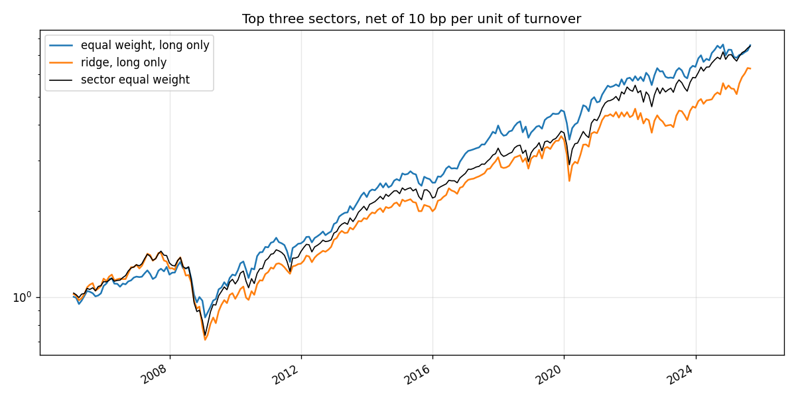

# sector-signal-backtest

[](https://github.com/aakashbansalgit/sector-signal-backtest/actions/workflows/tests.yml)

Five classic technical signals, tested without look-ahead on the nine S&P sector funds from 2005 to 2025. None predicts next month's returns significantly, and a learned combination does worse than a plain average.


A small systematic fund built as a set of independent signal agents, a portfolio manager that combines them, and a backtester that is strict about time. It rotates among the nine original S&P 500 sector funds once a month from 2005 to August 2025.

## How it works

`fund/agents.py` has five agents. Each looks at daily prices up to a month end and scores every sector:

- 12-1 month momentum
- one-month reversal
- low trailing volatility
- distance above the 200-day average
- 14-day RSI, where oversold scores higher

`fund/backtest.py` converts each agent's scores to cross-sectional ranks and combines them two ways. One is a plain average. The other is a ridge regression refitted every month on the previous 60 months of scores against the next month's sector returns, so the weight on each agent is learned from data the fund would have had at the time. The top three sectors by forecast are held long. A long-short version also shorts the bottom three. Every trade pays 10 bp per unit of turnover.

The universe is the nine SPDR sector funds that have traded since 1998, so no fund is in the sample because it survived. `tests/test_no_lookahead.py` changes every price after a month end and checks that no agent score and no ridge forecast for that month moves, and that later forecasts do move, so the test can fail.

There are no news, fundamentals or Google Trends signals. Those APIs return today's values, not what was known on a past date, so a backtest built on them would use information from the future.

## Results

Information coefficient is the rank correlation between an agent's scores and the next month's sector returns, across 308 month ends.

| Agent | Mean IC | IC std | t-stat | Months IC > 0 |
|---|---|---|---|---|
| 12-1 momentum | 0.010 | 0.450 | 0.40 | 50% |
| 1-month reversal | 0.011 | 0.433 | 0.44 | 53% |
| Low volatility | -0.007 | 0.451 | -0.26 | 50% |
| 200-day trend | 0.006 | 0.436 | 0.24 | 52% |
| 14-day RSI | 0.038 | 0.422 | 1.59 | 52% |

Portfolios, January 2005 to August 2025, net of costs. The ratio is return over volatility without subtracting the risk-free rate.

| | Return | Volatility | Return / vol | Max drawdown | Turnover a year | Active return | Information ratio |
|---|---|---|---|---|---|---|---|
| Equal weight, long only | 10.3% | 13.8% | 0.78 | 36.0% | 13.1 | -0.1% | -0.01 |
| Ridge, long only | 9.3% | 15.4% | 0.66 | 50.3% | 12.7 | -0.8% | -0.12 |
| Equal weight, long-short | -2.2% | 11.8% | -0.13 | 47.4% | 24.5 | | |
| Ridge, long-short | -2.9% | 11.6% | -0.20 | 54.5% | 25.4 | | |
| All nine sectors, equal weight | 10.2% | 14.7% | 0.74 | 49.1% | 0 | | |

None of these signals predicts sector returns with any reliability. The best, RSI, has a t-statistic of 1.6. The long-only portfolios roughly match holding all nine sectors, with a smaller drawdown for the equal-weight blend, and the long-short books lose money once 25 times annual turnover is paid for.

The learned combination does worse than the plain average. With nine assets a month, each IC has a standard deviation of about 0.45, so five years of data cannot tell a weight of 0.002 from noise, and the ridge spends its time chasing it. `figures/ridge_coefficients.png` shows three of the five weights crossing zero repeatedly, and only RSI staying positive in most months. The fundamental law of active management puts it in numbers: information ratio is roughly IC times the square root of breadth, and nine bets a month gives an IC of 0.04 almost nothing to work with. The way forward is more breadth, hundreds of stocks rather than nine sectors, not a cleverer combiner.

## Live paper portfolio

`fund/live.py` runs the same rules forward. In the first days of each month the agents score the nine sectors on the last month-end close, and both combinations pick their top three. The picks are committed before the month's returns exist, and a later run fills in how they did against holding all nine. Given the backtest, the honest expectation is that the picks roughly match the benchmark. This checks whether that holds out of sample.

<!-- live:start -->
The first picks will be made in the first days of November 2026.
<!-- live:end -->

## Running it

```
pip install numpy pandas scipy scikit-learn matplotlib yfinance
python -m fund.backtest
python -m fund.live          # this month's picks, and last month's returns
python tests/test_no_lookahead.py
```

The first run downloads prices into `data/prices.csv`. A full backtest takes about 20 seconds.
